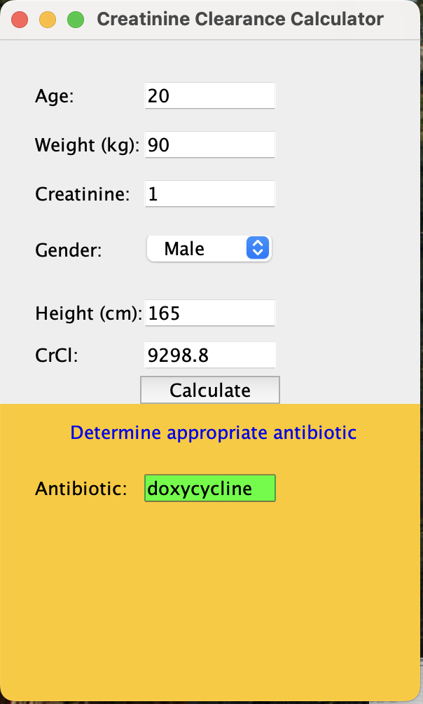

# Creatinine Clearance Calculator

A Java Swing desktop application that calculates creatinine clearance (CrCl) from patient inputs and displays simple colour indicators for selected antibiotic names.

> **Educational project only.** This application is not a medical device and must not be used to make treatment, prescribing, or dosing decisions. Its formula, assumptions, units, and antibiotic thresholds require review against current clinical references before any real-world use.

## Features

- Desktop graphical interface built with Java Swing
- Patient inputs for age, weight, serum creatinine, gender, and height
- Ideal body weight (IBW) calculation based on the selected gender
- Uses IBW when actual body weight is more than 120% of calculated IBW; otherwise uses actual body weight
- Displays CrCl rounded to two decimal places
- Colour indicators for selected antibiotic names:
  - **Doxycycline:** green
  - **Nitrofurantoin:** red at CrCl ≤30; yellow at CrCl >30 and ≤40; green at CrCl ≥40 (note: the current code checks the yellow condition first, so exactly 40 is yellow)
  - **Tazocin:** red at CrCl ≤10; other values currently fall through to the default white background

## Built with

- Java
- Java Swing (GUI)
- AWT event handling

## Project structure

```text
creatinine-clearance-calculator/
├── src/
│   └── CreatClearanceCalc.java
├── screenshots/
│   └── (add your application screenshot here)
├── README.md
└── .gitignore
```

## How to run

You need a Java Development Kit (JDK) installed.

### Compile

From the project root directory:

```bash
javac -d out src/CreatClearanceCalc.java
```

### Run

```bash
java -cp out CreatClearanceCalc
```

## Formula and assumptions in the current implementation

The code uses the following calculation structure:

```text
CrCl = N × (140 − age) × selected weight ÷ serum creatinine
```

- `N = 1.23` when Male is selected
- `N = 1.04` when Female is selected
- Height is entered in centimetres
- IBW is calculated as `50 + (height − 152)` for Male and `45 + (height − 152)` for Female
- If actual body weight is greater than 120% of IBW, the code uses IBW; otherwise it uses actual body weight
- The result is rounded to two decimal places

**Unit warning:** The constants 1.23 and 1.04 in this formula are intended for serum creatinine entered in **µmol/L**. The current interface does not display or validate the creatinine unit. Do not enter a value in mg/dL without using a correctly matched formula and unit conversion.

The weight-selection method and all formula assumptions should be checked against an authoritative clinical reference. This README documents the current code; it does not validate its clinical accuracy.

## Current limitations / future improvements

- Add input validation for blank, non-numeric, zero, and negative values
- Display the serum creatinine unit clearly beside the input
- Handle antibiotic colour updates safely when CrCl has not yet been calculated
- Update the colour logic when a new CrCl result is calculated
- Complete the Tazocin green condition for values above the chosen threshold, if supported by the project specification
- Review boundary conditions for antibiotic thresholds (especially CrCl = 40)
- Improve the layout, resizing behaviour, and accessibility
- Separate calculation logic from GUI code for easier testing and maintenance

## Disclaimer

This is a learning project created to practise Java programming, GUI development, event handling, and conditional logic. It is not intended for clinical use. Always rely on qualified healthcare professionals and validated clinical tools for patient care.
